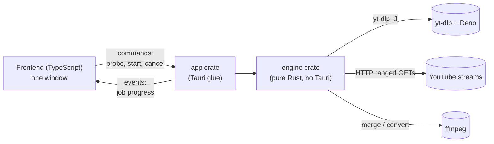

# YouTube Downloader — Design (V1)

**Date:** 2026-11-12
**Status:** Draft for approval
**Lives at:** `docs/superpowers/specs/2026-11-12-youtube-downloader-design.md` in the repo

Items marked **(Claude's call)** were decided by Claude, not Donny. They're open to change.

---

## 1. Intent and why

This is a personal desktop app for Windows. You paste a YouTube URL, choose a video or MP3, pick a resolution from what the video actually offers, choose a folder, and download.

**Why it exists:** the main goal is learning AI-assisted software development end to end: brainstorm, design, plan, build in small tested steps, review. Design and planning happen in Claude chat. The build happens in Claude Code. A secondary goal is learning Rust. The app will not be distributed.

## 2. Goals (V1)

- Paste a URL and see the video's title, duration, and thumbnail.
- Choose **Video** or **MP3**.
- For Video, choose from the resolutions this video actually offers (for example 2160p, 1440p, 1080p60, 720p).
- **Quality first:** always take the best available video and audio streams. Never re-encode video.
- Choose a save folder. The app remembers the last one.
- Show download progress, with a Cancel button.
- Use a modern, minimal ("discreet") interface.
- Download one video at a time. The architecture must let V2 add a queue without rewriting the engine.

## 3. Non-goals (V1)

Out of scope for V1:

- A download queue (planned for V2)
- Playlists, channels, and live streams
- Subtitles, chapters, and embedded thumbnails or metadata
- Choosing an MP3 bitrate
- Installers, auto-update, or distribution
- macOS and Linux
- Age-restricted, private, or members-only videos (these show a clear error)
- Installing or updating yt-dlp, ffmpeg, or Deno for the user

## 4. Anti-goals

These count as failures even if the app works:

- **Code Donny doesn't understand.** Build in small, reviewed steps. Each one should be explainable.
- **An engine tied to the UI.** If adding the V2 queue would mean rewriting download logic, the design failed.
- **Bundling or redistributing third-party tools.**

## 5. Constraints

- **Windows 10/11 only.** Tauri uses WebView2, which is built into Windows 11.
- **External tools the user installs on PATH:**
  - **yt-dlp** (recent; YouTube support changes often, so update it with `yt-dlp -U`)
  - **ffmpeg** (merges video and audio, converts to MP3)
  - **Deno**: yt-dlp needs an external JavaScript runtime for full YouTube support as of release 2025.11.12, and Deno is the recommended one.
- **Tauri 2** (stable)
- **Personal use only.** Downloading from YouTube generally violates its Terms of Service unless the content is yours or licensed.

## 6. Approaches considered

### 6.1 Download engine

| Option | Summary | Verdict |
|---|---|---|
| 1. Wrap yt-dlp fully | yt-dlp downloads and merges; Rust only drives the UI | Most reliable, least Rust learning. **Fallback if the spike fails (§10).** |
| **2. Hybrid** | yt-dlp only reads video info and stream URLs. Rust does the HTTP downloading, progress, and cancel, and runs ffmpeg | **Chosen by Donny.** Real Rust networking without tying the project's health to YouTube changes |
| 3. All Rust | Reimplement YouTube extraction | Rejected: mostly reverse-engineering YouTube rather than Rust, and breaks often |

### 6.2 UI toolkit

| Option | Summary | Verdict |
|---|---|---|
| **Tauri 2** | HTML/CSS/TypeScript screen with a Rust core | **Chosen by Donny.** Best modern look; AI is strongest at web UI |
| egui | Pure Rust, immediate mode | Dense "dev tool" look; hard to make polished |
| iced | Pure Rust, Elm-style | API changes between versions; AI often writes outdated code |
| Slint | Declarative, pure Rust | Dropped: less AI familiarity |

### 6.3 Scope

**Chosen by Donny:** one download at a time in V1, a queue in V2.

### 6.4 Video quality

**Chosen by Donny: quality first.** Always take the best streams. Use MP4 when the streams fit it, MKV otherwise.

---

## 7. Design

### 7.1 Architecture



Cargo workspace with two crates:

- **`engine`**: library crate with **no dependency on Tauri**. It owns probing, format selection, downloading, ffmpeg, and job events, and it can be tested without the UI.
- **`app`**: the Tauri crate. It turns frontend commands into engine calls and forwards engine events to the frontend.

### 7.2 Engine API (the V2 seam)

```rust
probe(url) -> Result<VideoInfo>
start(job: DownloadJob, events: Sender<JobEvent>) -> JobId
cancel(job_id)

VideoInfo   { title, duration, thumbnail_url, video_options: Vec<VideoOption>, has_audio }
VideoOption { label /* "1080p60" */, height, fps, codec, est_size }
DownloadJob { url, kind: Video(VideoOption) | Mp3, folder }
JobEvent    { job_id, kind: Phase(..) | Progress{done, total} | Done{path} | Failed{msg} | Cancelled }
```

- Every event carries a `job_id`, even though V1 has only one job. V2's queue sends more jobs through the same `start` and filters events by ID, with no engine changes.
- In V1, the **app** (not the engine) refuses to start a second job while one is running.
- Phases: Probing, Downloading video, Downloading audio, Merging or Converting, then Done.

### 7.3 Download flow

**Probe:** run `yt-dlp -J --no-playlist <url>`, then parse the JSON with `serde`. Each format includes its stream URL and the HTTP headers to use.

**Video:**
1. Take the best **video-only** stream at the chosen resolution, ranked by yt-dlp's own format ordering, plus the best **audio-only** stream.
2. Download both with `reqwest`, using the headers from the JSON, in ranged chunks so progress is accurate and Cancel responds quickly.
3. Merge with `ffmpeg -c copy` (no re-encoding).
4. **Container:** MP4 when the video is H.264 and the audio is AAC; otherwise MKV.

**MP3:** download the best audio-only stream and convert it with ffmpeg at high-quality VBR (`-q:a 0`). **(Claude's call)**

**Temp files:** stored in the target folder as `*.part`. They're deleted on cancel or failure, and removed after a successful merge.

**File names:** the video title with characters Windows doesn't allow removed. If the name is taken, append ` (1)`, ` (2)`, and so on. Files are never overwritten. **(Claude's call)**

### 7.4 Resolution list

- Built from the video-only streams: one entry per distinct height and frame rate (for example "1080p60" and "1080p" are separate).
- Ordered highest first, with the highest preselected. **(Claude's call)**
- Each entry shows the estimated size when YouTube provides one. **(Claude's call)**

### 7.5 UI

A single small window **(Claude's call: about 420×600, resizable)**:

```
┌──────────────────────────────────────┐
│ [ Paste a YouTube link            ]  │
│ ┌────┐ Some video title              │
│ └────┘ 12:34                         │
│ [  Video  |  MP3  ]                  │
│ [ 1080p60  ~240 MB ▾ ]  [📁]         │
│ C:\Users\...\Downloads               │
│ [          Download          ]       │
│ ▓▓▓▓▓▓░░░░░░  Downloading video 40%  │
│                        [ Cancel ]    │
└──────────────────────────────────────┘
```

- **States:** empty, probing, ready, downloading, done (with "Open folder"), and error (with a plain-language message).
- Pasting a URL triggers the probe automatically, with no Go button. **(Claude's call)**
- The light/dark theme follows Windows. **(Claude's call)**
- The frontend is **plain TypeScript with Vite, no framework**, because the UI is one screen. **(Claude's call)**
- The look follows the Tauri mockup from the brainstorm: rounded corners, a segmented Video/MP3 toggle, one accent-colored button, and a thin progress bar.

### 7.6 Startup check

On launch, the app checks that `yt-dlp`, `ffmpeg`, and `deno` are on PATH. If any are missing, it shows which ones and how to install them, and downloads stay disabled until they're found.

### 7.7 Settings

The last-used folder is saved with `tauri-plugin-store`. The first-run default is the user's Downloads folder. **(Claude's call)**

---

## 8. Testing

- **Engine unit tests** use saved `yt-dlp -J` JSON files as fixtures, with no network. They cover:
  - format selection per resolution
  - building the resolution list
  - choosing MP4 vs. MKV
  - cleaning file names and handling name conflicts
  - the order of job events
- **Network tests** are marked `#[ignore]` and run manually against one known public video.
- **UI:** a manual checklist covering each screen state, Cancel during each phase, and missing-tool messages.
- Work test-first wherever the engine allows.

## 9. Left to the builder

- Exact crate versions and HTTP chunk size
- Exact ffmpeg arguments, beyond "stream copy" and "MP3 at `-q:a 0`"
- Visual polish details within the mockup's direction
- Error message wording (plain language, with a suggested next step)

## 10. Risks

| Risk | Plan |
|---|---|
| YouTube blocks or throttles stream downloads made by Rust instead of yt-dlp | **The first plan task is a spike.** Probe one video, then download one stream with `reqwest` using yt-dlp's URL and headers. If it fails, switch the engine internals to approach #1 (yt-dlp downloads, progress parsed from its output). The engine API in §7.2 stays the same, so the UI is unaffected. |
| YouTube changes break yt-dlp | The error message suggests running `yt-dlp -U` |
| MKV files won't play in some players | Accepted as part of "quality first." Modern players such as VLC and mpv handle MKV. |

## 11. V2 notes (don't build yet)

- A queue of jobs feeding `engine::start`, with an event stream per job.
- UI: a list of jobs with their own progress and Cancel buttons.
- Possibly: limit how many jobs run at once.
